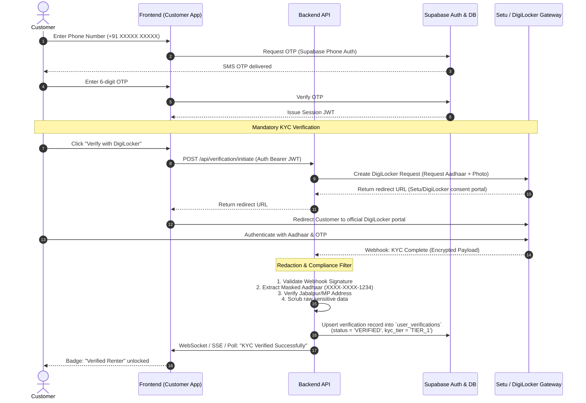

# 🔄 Jabalpur Rent — End-to-End Data Flows

> **Overview**: Detailed sequence diagrams mapping the lifecycle of data across the client, backend, database, and external Indian fintech gateways.

---

## 1. Flow 1: Customer Registration & DigiLocker KYC Onboarding



---

## 2. Flow 2: Concurrency-Safe Booking & Online Payment

```mermaid
sequenceDiagram
    autonumber
    actor C as Customer
    participant W as Frontend
    participant B as Backend API
    participant DB as Supabase PostgreSQL
    participant PG as Razorpay / Cashfree Gateway

    C->>W: Select Phone & Rental Dates (e.g., Nov 10 to Nov 13)
    W->>B: POST /api/bookings/quote (phone_id, start_date, end_date)
    B->>DB: Check availability & calculate fee + deposit
    DB-->>B: Return breakdown: Rental ₹3,600 + Deposit ₹5,000 = ₹8,600
    B-->>W: Render Quote with itemized breakdown

    C->>W: Click "Confirm & Pay ₹8,600"
    W->>B: POST /api/bookings/initiate (phone_id, dates, user_id)
    
    Note over B,DB: Concurrency-Safe Lock
    B->>DB: BEGIN TRANSACTION<br/>SELECT * FROM physical_devices WHERE id = ? FOR UPDATE;<br/>Check overlapping reservations in `bookings`;<br/>INSERT INTO bookings (status = 'PENDING_PAYMENT', expires_at = NOW() + 15 mins);<br/>COMMIT;
    
    B->>PG: Create Order (amount = ₹860,000 paise, currency = 'INR', notes = {booking_id})
    PG-->>B: Return `order_id`
    B-->>W: Return `order_id` & public `key_id`
    
    W->>PG: Open Razorpay Checkout modal
    C->>PG: Pay via UPI / Netbanking / Debit Card
    PG-->>W: Client callback (razorpay_payment_id, signature)
    
    Note over PG,B: Server-to-Server Webhook (Authoritative)
    PG->>B: POST /api/payments/webhook (Payload + HMAC Header)
    B->>B: Verify HMAC-SHA256 signature using Secret Key
    B->>DB: Check idempotency key in `payment_events` table
    alt Webhook Already Processed
        B-->>PG: HTTP 200 (Already handled)
    else First Processing
        B->>DB: BEGIN TRANSACTION;<br/>INSERT INTO payment_events (...);<br/>UPDATE bookings SET status = 'CONFIRMED', pickup_otp = '849201';<br/>INSERT INTO audit_logs (...);<br/>COMMIT;
        B-->>PG: HTTP 200 OK
        B->>C: Send SMS/WhatsApp: "Booking Confirmed! Pickup OTP: 849201"
    end
```

---

## 3. Flow 3: Physical Device Handover at Jabalpur Shop

```mermaid
sequenceDiagram
    autonumber
    actor C as Customer
    actor S as Shop Partner
    participant SW as Shop Portal (Web)
    participant B as Backend API
    participant DB as Supabase DB

    C->>S: Arrives at shop in Russell Chowk / Sadar
    S->>SW: Search Booking by Customer Phone or Booking ID
    SW->>B: GET /api/shop/bookings/:id
    B-->>SW: Return Booking details & required verification steps

    S->>C: Request 6-digit Pickup OTP
    C->>S: Provides OTP "849201"
    
    Note over S,SW: Physical Condition Inspection
    S->>SW: 1. Confirm device IMEI matches physical hardware<br/>2. Inspect screen, cameras, and edges<br/>3. Upload 4-angle condition photos to shop portal<br/>4. Enter Pickup OTP
    
    SW->>B: POST /api/shop/handover (booking_id, otp, condition_notes, photo_urls)
    B->>DB: Verify OTP & expiration;<br/>UPDATE bookings SET status = 'HANDED_OVER', handed_over_at = NOW();<br/>UPDATE physical_devices SET status = 'RENTED';
    B-->>SW: Handover Confirmed!
    SW-->>S: "Handover successful. Rental clock started."
    B->>C: Send SMS: "Phone handed over. Return due: Nov 13, 18:00."
```

---

## 4. Flow 4: Device Return, Inspection & Deposit Refund

```mermaid
sequenceDiagram
    autonumber
    actor C as Customer
    actor S as Shop Partner
    participant SW as Shop Portal
    participant B as Backend API
    participant DB as Supabase DB
    participant PG as Payment Gateway

    C->>S: Returns device at shop
    
    Note over S,C: Return Checklist
    S->>C: 1. Verify customer signed out of Apple ID / Google Account<br/>2. Verify Factory Reset complete / clean<br/>3. Verify physical IMEI & screen condition
    
    S->>SW: Open "Complete Return" screen
    S->>SW: Mark: "Device returned in clean condition. No damage."
    C->>SW: Generates & shares Return OTP from Customer App
    S->>SW: Submit Return OTP

    SW->>B: POST /api/shop/return (booking_id, return_otp, damage_fee = 0)
    B->>DB: BEGIN TRANSACTION;<br/>Verify return OTP;<br/>UPDATE bookings SET status = 'RETURNED', returned_at = NOW();<br/>UPDATE physical_devices SET status = 'AVAILABLE';<br/>COMMIT;
    
    Note over B,PG: Automated Instant Refund
    B->>PG: POST /refunds (payment_id, amount = ₹5,000 deposit, reason = 'Rental Deposit Return')
    PG-->>B: Refund Initiated (refund_id)
    B->>DB: UPDATE payments SET deposit_refund_id = ?, deposit_status = 'REFUNDED'
    
    B->>C: SMS: "Device returned! Your ₹5,000 security deposit refund is on its way."
    B->>S: Payout of ₹3,060 scheduled in next payout cycle.
```

---

## 5. Related Links
- High-level architecture: [[System-Architecture]]
- Database schema: [[Database-Schema]]
- Payment gateway details: [[Payment-Integration]]
- Identity verification details: [[Verification-Provider]]
