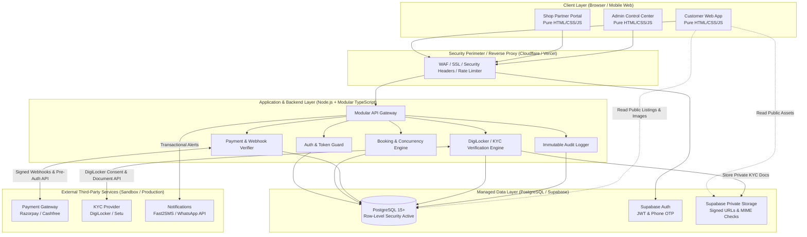

# 🏗️ Jabalpur Rent — System Architecture

> **Architecture Philosophy**: Simple, modular, maintainable, and secure. We avoid over-engineered microservices and bloated frameworks, favoring a clean three-tier architecture with defense-in-depth security.

---

## 1. High-Level Architecture Overview

---

## 2. Core Architectural Components

### A. Frontend Layer (Customer, Shop, Admin)
- **Technology**: Vanilla HTML5, modern CSS3 (Custom Properties / Design Tokens), and modular Vanilla JavaScript (ES modules).
- **Rationale**:
  - Extremely fast load times on mobile 4G networks in Jabalpur.
  - Zero framework churn (no React/Next.js hydration delays, dependency bloat, or breaking library updates).
  - Clean separation into three intuitive portals:
    1. **Customer Web App**: Browsing, filtering by Jabalpur areas (Sadar, Gorakhpur), KYC onboarding, checkout, booking management.
    2. **Shop Partner Portal**: Inventory onboarding, real-time availability toggling, handover and return OTP verification.
    3. **Admin Control Center**: Shop verification, customer KYC review, dispute arbitration, transaction monitoring.

### B. Backend Application Layer (Modular TypeScript)
- **Technology**: Node.js with TypeScript and modular route handlers.
- **Why a backend is mandatory (avoiding pure client-to-Supabase direct writes)**:
  1. **Webhook Security**: Payment gateway callbacks (Razorpay/Cashfree) carry cryptographic signatures (`x-razorpay-signature`) that **must** be validated using secret keys that can never exist in the browser.
  2. **Idempotency**: Webhook deliveries can be retried by gateways multiple times; the backend guarantees exactly-once processing using database transaction locks.
  3. **KYC Document Redaction**: Incoming identity payloads from DigiLocker must be scrubbed to mask Aadhaar numbers (`XXXX-XXXX-1234`) on the server before storage.
  4. **Strict Concurrency**: Prevents race conditions during simultaneous booking attempts.

### C. Managed Data & Authentication Layer (PostgreSQL / Supabase)
- **Technology**: Managed PostgreSQL via Supabase.
- **Security Posture**:
  - **Row-Level Security (RLS)**: Enforced unconditionally on every table. Even if an attacker manipulates API requests, the database engine drops unauthorized read/write attempts.
  - **Private Storage**: KYC files and shop registration licenses reside in non-public buckets. Access is granted solely via temporary cryptographically signed URLs (15-minute expiration).

---

## 3. Strict Security Boundaries

| Zone | Trusted? | Key Protections |
| :--- | :--- | :--- |
| **Browser (Client)** | ❌ Untrusted | Input validation, sanitization, zero secret keys. Never trusts prices from client. |
| **Edge / WAF** | 🛡️ Perimeter | SSL termination, DDoS protection, rate limiting on sensitive endpoints (`/auth/otp`, `/bookings/create`). |
| **Backend API** | 🔒 Fully Trusted | Holds gateway secrets, verifies HMAC signatures, sanitizes payloads, runs business logic. |
| **Database** | 🏰 Core Vault | RLS policies, check constraints, foreign keys, audit logging triggers, exclusion constraints. |

---

## 4. Hardware Asset Tracking Topology

In Jabalpur Rent, a "Listing" is a catalog entry (e.g., *iPhone 15 Pro 128GB Black Titanium*), but a **"Physical Device"** (`devices` table) represents the exact physical hardware item sitting in a shop:
- Every physical phone has a unique `imei_hash`, `serial_number`, battery health percentage, and cosmetic condition rating.
- Bookings reserve a **specific physical device**, preventing inventory virtualization bugs.

---

## 5. Related Architecture Documents
- Directory structure: [[Folder-Structure]]
- Detailed interaction flows: [[Data-Flow]]
- Architecture Decision Records: [[Architecture-Decisions]]
- Database schema: [[Database-Schema]]
