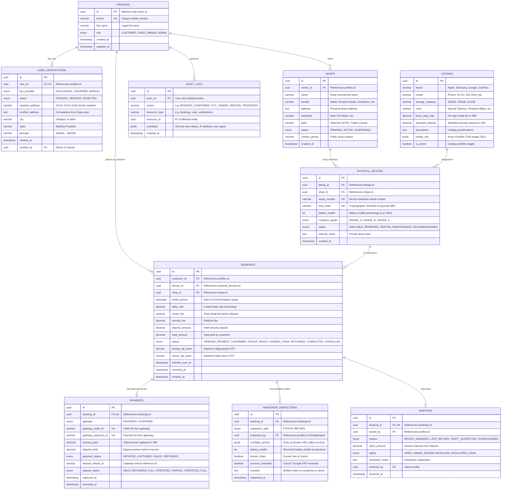

# 🗄️ Jabalpur Rent — Entity Relationship Diagram (ERD)

> **Database Engine**: PostgreSQL 15+ (Hosted on Supabase)  
> **Topology**: Strict third-normal form (3NF) relational model with foreign key constraints, check constraints, and immutable audit logs.

---

## 1. Complete Entity Relationship Diagram (Mermaid)

---

## 2. Key Architectural Guarantees of this Topology

1. **Decoupling of Catalog from Physical Units**:
   - `LISTINGS` stores generic smartphone specs (e.g., iPhone 15 Pro 128GB).
   - `PHYSICAL_DEVICES` stores exact physical hardware assets located in a specific Jabalpur shop with `imei_hash` and `battery_health`.
2. **Concurrency Safety with Exclusion Constraints**:
   - `BOOKINGS` uses PostgreSQL's native `tstzrange` column type (`rental_period`).
   - Using PostgreSQL `btree_gist` extension, we enforce that no two non-cancelled bookings can have overlapping `rental_period` for the same `device_id`.
3. **Strict Compliance & Redaction**:
   - `USER_VERIFICATIONS` stores `masked_aadhaar` (`XXXX-XXXX-1234`), entirely eliminating the liability of handling raw Aadhaar numbers.
4. **Financial Idempotency**:
   - `PAYMENTS` enforces unique constraints on `gateway_order_id` and `gateway_payment_id`, mathematically preventing duplicate webhook credits.

---

## 3. Related Links
- Detailed SQL DDL schema: [[Database-Schema]]
- Row-Level Security policies: [[Access-Policies]]
- Migrations history: [[Migrations-Log]]
