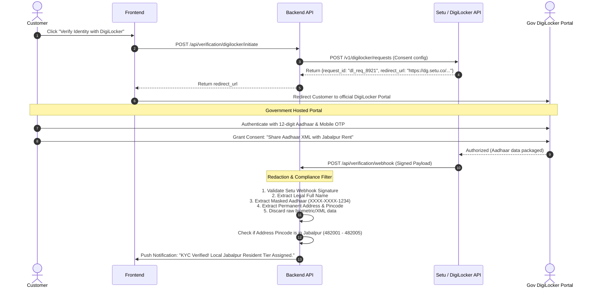

# 🆔 Jabalpur Rent — Identity & KYC Verification Integration

> **Primary Provider Strategy**: DigiLocker API via Setu / Cashfree Verification Suite.  
> **Compliance Priority**: Masked Aadhaar storage only (`XXXX-XXXX-1234`), 100% compliant with UIDAI regulations and DPDP Act 2023.

---

## 1. DigiLocker KYC Verification Flow



---

## 2. Verification Tiers & Risk Profile

| Tier Level | Name | Requirements | Benefits | Security Deposit Required |
| :---: | :--- | :--- | :--- | :---: |
| **Tier 0** | Unverified | Mobile OTP only | Can browse only; **cannot book hardware** | N/A |
| **Tier 1** | Verified Jabalpur Resident | DigiLocker OKYC with Jabalpur address (482001-482005) | Can book up to 2 devices simultaneously | Standard Deposit (₹5,000 for iPhone 15 Pro) |
| **Tier 2** | Verified Tourist / Outstation | DigiLocker OKYC with non-Jabalpur address + Hotel/Stay proof | Can book 1 device | Higher Deposit (₹8,000 - ₹10,000) |
| **Tier 3** | Verified Student (IIITDM / JEC / Medical) | DigiLocker OKYC + Verified Student ID | 10% student discount | Standard Deposit |

---

## 3. Server Redaction Filter (Code Blueprint)

```typescript
export function sanitizeDigiLockerPayload(payload: any) {
  const rawAadhaar = payload.document?.aadhaar_number || '';
  
  // Enforce UIDAI masking: replace first 8 digits with 'X'
  const lastFour = rawAadhaar.slice(-4);
  const maskedAadhaar = `XXXX-XXXX-${lastFour}`;

  return {
    verified_name: payload.document?.name,
    masked_aadhaar: maskedAadhaar,
    date_of_birth: payload.document?.dob,
    verified_address: payload.document?.address,
    city: payload.document?.city || 'Jabalpur',
    state: payload.document?.state || 'Madhya Pradesh',
    pincode: payload.document?.pincode,
    document_hash: crypto.createHash('sha256').update(JSON.stringify(payload)).digest('hex')
  };
}
```

---

## 4. Related Links
- Provider research: [[Provider-Research]]
- Privacy & data retention: [[Privacy-and-Data-Retention]]
- Database schema: [[Database-Schema]]
