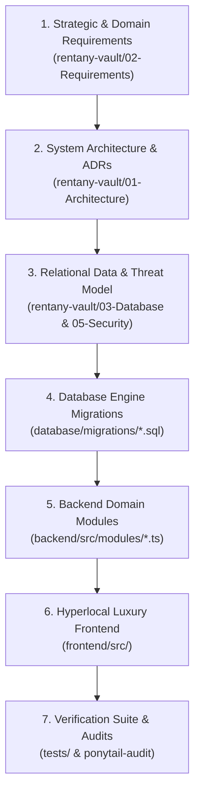

# 📑 RENTANY — Master File Audit Sequence & Flow Guide

> **Auditor's Handbook**: This document lists every single file in the RENTANY project in the exact chronological order of creation and functional flow. Follow this order to audit the entire system from core business assumptions down to low-level database constraints, API endpoints, user interfaces, and automated test suites.

---

## 🧭 Flow Overview: The 7 Pillars of RENTANY



---

## 📋 Comprehensive File-by-File Audit Sequence

### Phase 1: Business Intent, Governance & Architecture

| Seq # | File Path | Type | Purpose & Flow | What to Audit First |
|:---:|:---|:---|:---|:---|
| **01** | `rentany-vault/PROJECT-OVERVIEW.md` | Markdown | Mission & Jabalpur market context. Explains the local retail phone ecosystem (Sadar, Russell Chowk, Gorakhpur, Wright Town). | Stakeholder alignment, 20% platform fee model, 80% merchant payout model. |
| **02** | `rentany-vault/02-Requirements/MVP-Scope.md` | Markdown | Strict MVP boundary. Enforces YAGNI by defining what is included vs deferred to Phase 2. | Verify no feature creep; check that courier delivery is deferred in favor of in-person counter pickup. |
| **03** | `rentany-vault/02-Requirements/User-Stories.md` | Markdown | Acceptance criteria for Customer, Shopkeeper, and Platform Admin. | Ensure every acceptance test maps to concrete UI and API contracts. |
| **04** | `rentany-vault/01-Architecture/Architecture-Decisions.md` | Markdown | ADRs 001 through 009 recording why tech decisions were made. | Scrutinize ADR-004 (DigiLocker KYC), ADR-005 (Upfront deposit + automated refund), ADR-006 (PostgreSQL GiST concurrency exclusion). |
| **05** | `rentany-vault/03-Database/Database-Schema.md` | Markdown | Full entity-relationship schema specification with 10 tables. | Foreign key constraints, cascade rules, and `tstzrange` column definition. |
| **06** | `rentany-vault/03-Database/Row-Level-Security.md` | Markdown | Zero-trust multi-tenant isolation rules. | Verify that shopkeepers cannot read other shops' inventory or payout amounts. |
| **07** | `rentany-vault/05-Security/Threat-Model.md` | Markdown | STRIDE threat model & UIDAI Aadhaar Act 2016 privacy compliance. | Check anti-theft controls, IMEI hash privacy, and strict Aadhaar masking regex (`^XXXX-XXXX-[0-9]{4}$`). |
| **08** | `rentany-vault/05-Security/Security-Checklist.md` | Markdown | Concrete verification checklist for production readiness. | Audit secrets management, HTTPS enforcement, and rate-limiting limits. |
| **09** | `rentany-vault/08-Operations/Brand-Identity.md` | Markdown | Visual system definition: Royal Crimson (`#B21F3A`), Champagne Gold (`#EDC79B`), Deep Espresso (`#3D250B`). | Check color tokens and asset mapping from `d:\RENTANY\ASSETS\`. |

---

### Phase 2: Hyperlocal Natural Luxury Frontend

| Seq # | File Path | Type | Purpose & Flow | What to Audit First |
|:---:|:---|:---|:---|:---|
| **10** | `frontend/src/css/variables.css` | CSS | Global design tokens, HSL surfaces, typography, shadows. | Check `--color-primary` (`#B21F3A`), `--color-gold` (`#EDC79B`), and responsive spacing scales. |
| **11** | `frontend/src/css/base.css` | CSS | Reset, modern font stacks, background stipple texture (`ingredient14.svg`). | Ensure zero external Google Font latency dependencies; typography falls back cleanly. |
| **12** | `frontend/src/css/components.css` | CSS | Reusable cards, buttons, badges, modals, flourish dividers, ambient botanicals. | Inspect hover transitions, glassmorphic backdrop filters, and mobile viewport responsiveness. |
| **13** | `frontend/src/js/mock-data.js` | JS (ESM) | Canonical Jabalpur dataset: 4 shops, 8 luxury phone listings, studio photo paths. | Verify `new URL(..., import.meta.url).href` pattern prevents 404s on GitHub Pages subpaths. |
| **14** | `frontend/src/js/utils.js` | JS (ESM) | Core business math: 10% discount for 3+ days, 20% for 7+ days, resident vs tourist deposit. | Math precision (no floating point pennies), Indian currency formatter (`en-IN`). |
| **15** | `frontend/index.html` | HTML | Marketplace Homepage: Hero banner, locality pills, curated Jabalpur stories, phone showcase. | Check SEO meta tags, OpenGraph tags, semantic HTML5 landmarks, and asset links. |
| **16** | `frontend/src/customer/catalog.html` | HTML | Multi-facet phone catalog with real-time brand, price, and locality filters. | Filter reactivity, zero result empty states, and direct link to device detail view. |
| **17** | `frontend/src/customer/device.html` | HTML | Device detail view: Interactive rental duration slider, camera specs, deposit breakdown. | Price slider updates totals immediately; Aadhaar resident checkbox toggles ₹3k vs ₹8k deposit. |
| **18** | `frontend/src/customer/checkout.html` | HTML | Checkout & verification portal: DigiLocker badge, simulated Razorpay modal. | Verify no sensitive user credentials are saved locally; clean transition to confirmation pass. |
| **19** | `frontend/src/customer/bookings.html` | HTML | Customer reservation dashboard with Digital Pickup Pass and 6-digit OTP `849 201`. | QR code rendering, 6-digit counter security OTP, deposit escrow status badge. |
| **20** | `frontend/src/shop/dashboard.html` | HTML | Shopkeeper terminal: Active reservations, counter pickups due, 80% payout balance. | Verify shop stats isolate local store data from platform aggregates. |
| **21** | `frontend/src/shop/inventory.html` | HTML | Shopkeeper device registry: Add IMEI (hashed), set battery health %, condition grading. | IMEI field must mask input; battery health validation between 50% and 100%. |
| **22** | `frontend/src/shop/handover.html` | HTML | Store Counter Handover Terminal: Enter customer OTP, record condition photos, issue refund. | Verify that refund trigger requires inspection checklist confirmation. |
| **23** | `frontend/src/admin/dashboard.html` | HTML | Platform Operator Command Center: 20% revenue analytics, merchant vetting queue. | Platform fee calculation, shop KYC verification toggle, tamper audit log viewer. |

---

### Phase 3: Database Engine Migrations & RLS Policies

| Seq # | File Path | Type | Purpose & Flow | What to Audit First |
|:---:|:---|:---|:---|:---|
| **24** | `database/migrations/20261027000001_extensions_and_enums.sql` | SQL | PostgreSQL prerequisites: `uuid-ossp`, `btree_gist`, custom domain enums. | Verify enum types: `user_role`, `verification_status`, `booking_status`, `payment_status`. |
| **25** | `database/migrations/20261027000002_core_tables.sql` | SQL | 10 Relational tables: `profiles`, `verifications`, `shops`, `listings`, `devices`, `bookings`, `payments`, `inspections`, `disputes`, `audit_logs`. | Strict CHECK constraints (e.g. `masked_aadhaar ~ '^XXXX-XXXX-[0-9]{4}$'`), foreign keys with `ON DELETE RESTRICT`. |
| **26** | `database/migrations/20261027000003_constraints_and_indexes.sql` | SQL | Hardware-level exclusion constraint preventing physical double-bookings. | `EXCLUDE USING gist (device_id WITH =, rental_period WITH &&) WHERE (status NOT IN ('CANCELLED'))`. |
| **27** | `database/migrations/20261027000004_row_level_security.sql` | SQL | Row Level Security policies for all tables. | Customer can only read own bookings; shop owner can only see own store devices; admin has global audit read. |
| **28** | `database/migrations/20261027000005_storage_buckets.sql` | SQL | S3 storage bucket configuration & signed URL policies. | `listing-images` (public read); `verification-documents-private` (signed URL only, 15m expiry). |
| **29** | `database/migrations/20261027000006_audit_triggers.sql` | SQL | Automated `updated_at` timestamps and tamper-proof booking audit trail trigger. | Immutable trigger function copying booking state deltas into `audit_logs` table. |
| **30** | `database/migrations/20261027000007_seed_data.sql` | SQL | Production-ready Jabalpur seed data: 4 real partner shops, physical units, demo admin. | Verify valid UUIDs, consistent geolocation coordinates (Sadar, Russell Chowk, Gorakhpur, Wright Town). |

---

### Phase 4: Shop Management, Listings & Inventory Backend

| Seq # | File Path | Type | Purpose & Flow | What to Audit First |
|:---:|:---|:---|:---|:---|
| **31** | `backend/src/config/env.ts` | TypeScript | Environment configuration and validation. | Strict typing, fallback test values for offline development, port configuration. |
| **32** | `backend/src/middleware/auth.middleware.ts` | TypeScript | Token verification and role-based access guard. | Rejection of unauthenticated calls; role matching (`ADMIN`, `SHOP_OWNER`, `CUSTOMER`). |
| **33** | `backend/src/modules/db.ts` | TypeScript | Lightweight database query & client helper. | Minimal dependency wrapper, parameterized queries to prevent SQL injection. |
| **34** | `backend/src/modules/shops.ts` | TypeScript | Shop registration, verification review, and status management. | Trade license validation, Jabalpur locality restriction. |
| **35** | `backend/src/modules/inventory.ts` | TypeScript | Physical device registration, IMEI SHA-256 hashing, battery health validation. | Verify that raw IMEI is NEVER stored in plaintext; battery health must be >= 80% to list. |
| **36** | `backend/src/modules/catalog.ts` | TypeScript | Public catalog queries with filtering and availability lookups. | Efficient filtering by brand, locality, daily price; excludes delisted/maintenance devices. |

---

### Phase 5: Concurrency-Safe Booking & Handover Engine

| Seq # | File Path | Type | Purpose & Flow | What to Audit First |
|:---:|:---|:---|:---|:---|
| **37** | `backend/src/modules/pricing.ts` | TypeScript | Deterministic pricing calculator with duration discounts and fee splits. | 10% discount for >= 3 days, 20% discount for >= 7 days; 20% platform commission, 80% shop share. |
| **38** | `backend/src/modules/bookings.ts` | TypeScript | Concurrency-safe reservation creation with 6-digit cryptographically secure OTP. | Cryptographic OTP generation (`crypto.randomInt`), database range exclusion catch. |
| **39** | `backend/src/modules/handover.ts` | TypeScript | In-person store counter handover and device return inspection with deposit refund. | 6-digit OTP verification; automatic calculation of damage deduction and net refund amount. |

---

### Phase 6: DigiLocker OKYC & Razorpay Escrow Integration

| Seq # | File Path | Type | Purpose & Flow | What to Audit First |
|:---:|:---|:---|:---|:---|
| **40** | `backend/src/modules/kyc.ts` | TypeScript | Government DigiLocker OKYC integration & UIDAI compliance filter. | Aadhaar number masking (`XXXX-XXXX-1234`), Jabalpur pincode resident verification (`482001` - `482008`). |
| **41** | `backend/src/modules/payments.ts` | TypeScript | Razorpay order creation, payment signature verification, webhook handler, automated instant refund. | Webhook HMAC-SHA256 signature verification; idempotency on webhook events; escrow split. |

---

### Phase 7: Automated Testing, Hardening & Deployment

| Seq # | File Path | Type | Purpose & Flow | What to Audit First |
|:---:|:---|:---|:---|:---|
| **42** | `tests/unit/pricing.test.ts` | TypeScript/Node | Unit tests for duration discounts, commission split, and deposit calculations. | Run: verifies rounding, edge cases (1 day, 3 days, 7 days, 30 days). |
| **43** | `tests/unit/otp.test.ts` | TypeScript/Node | Unit tests for 6-digit OTP cryptographic generation and verification. | Entropy check, expiry window, invalid attempt lockout. |
| **44** | `tests/unit/kyc-masking.test.ts` | TypeScript/Node | Security test for UIDAI Aadhaar masking regex and sensitive data redaction. | Confirms no raw 12-digit number can pass validation. |
| **45** | `tests/integration/concurrency.test.ts` | TypeScript/Node | Integration test simulating simultaneous booking requests for the same physical device. | Confirms exact 1 succeeds and 1 fails with concurrency conflict error. |
| **46** | `tests/run-all.ts` | TypeScript/Node | Master test runner executing all test suites with zero external test framework bloat. | Terminal output passes with 0 failures. |
| **47** | `.github/workflows/deploy.yml` | GitHub Actions | Automated GitHub Pages static build and deployment pipeline. | Valid branch target (`master`), artifact path (`frontend/`). |
| **48** | `index.html` | HTML | Root landing redirect ensuring smooth domain routing on GitHub Pages. | Instant redirect to `frontend/index.html`. |
| **49** | `rentany-vault/PROJECT-STATUS.md` | Markdown | Comprehensive heartbeat showing 100% completion across all 7 phases. | Status badges, phase deliverable checklists. |
| **50** | `rentany-vault/09-Session-Logs/` | Markdown | Chronological session audit logs detailing every architectural and implementation turn. | Detailed timestamps, decisions, and security review notes. |

---

## 🔍 How to Perform an Audit Using This Guide

1. **Step-by-Step Traversal**: Open each file in numerical sequence (01 to 50).
2. **Verify Against Requirements**: Every business rule in `02-Requirements/MVP-Scope.md` must have an exact corresponding implementation in `backend/` and `frontend/`.
3. **Execute the Verification Suite**:
   ```bash
   npx ts-node tests/run-all.ts
   ```
4. **Inspect Audit Findings**: Run `/ponytail-audit` to confirm zero unused code, zero security holes, and lean architectural purity.
