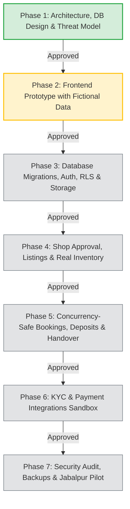

# 🗺️ Jabalpur Rent — Master Development Plan (7 Phases)

> **Development Philosophy**: Strict phase-gating. Complete and document the acceptance criteria of each phase before advancing to the next. Never implement all phases in one operation.

---

## 🎯 The 7 Development Phases

---

## 📋 Detailed Phase Breakdown & Acceptance Criteria

### Phase 1: Requirements, Architecture, Database Design & Threat Model
- **Focus**: Pure planning, foundational architecture, security modeling, and documentation setup.
- **Key Deliverables**:
  1. Monorepo folder layout and Obsidian vault initialization.
  2. Complete documentation across all 10 core areas.
  3. Relational PostgreSQL schema with integrity constraints and audit fields.
  4. Role-based access control (RBAC) matrix for Customer, Shop, Admin.
  5. STRIDE threat model and prioritized security checklist.
  6. Real-world provider research and verifiable cost tracking.
- **Acceptance Criteria**:
  - [x] Zero application source code implemented prematurely.
  - [x] All 10 Obsidian vault directories created and linked via `Home.md`.
  - [x] Founder reviews and grants explicit approval to begin Phase 2.

---

### Phase 2: Frontend Prototype with Fictional Data
- **Focus**: Visual excellence, responsive UX, and complete user journeys using pure HTML5, CSS3, and Vanilla JavaScript.
- **Key Deliverables**:
  1. Design system with modern typography, dark/light harmonious palette, and fluid micro-animations.
  2. Customer Portal:
     - Hero discovery with Jabalpur location filter (Sadar, Gorakhpur, Wright Town).
     - Phone catalog with category filters (iOS, Android Flagship, Creator Kits).
     - Phone detail page with transparent daily pricing and refundable deposit breakdown.
     - Mock date-picker and booking summary.
  3. Shop Partner Portal:
     - Shop dashboard with inventory status (Available, Rented, In Maintenance).
     - Listing creation form (IMEI, model, condition, photos).
     - Active rental handover and return verification UI.
  4. Platform Admin Portal:
     - Shop approval queue.
     - Customer verification audit dashboard.
     - Dispute & deposit settlement overview.
- **Acceptance Criteria**:
  - [ ] 100% responsive across mobile (360px+), tablet, and desktop viewports.
  - [ ] Zero placeholder image broken links; high-quality assets used.
  - [ ] Interactive mock workflows for Customer, Shopkeeper, and Admin without backend crashes.

---

### Phase 3: Database Migrations, Authentication, Authorization, RLS & Private Storage
- **Focus**: Supabase backend infrastructure, PostgreSQL schema deployment, Row-Level Security, and private document buckets.
- **Key Deliverables**:
  1. Clean, reversible SQL migrations for all tables, enums, triggers, and indexes.
  2. Supabase Auth integration (Phone OTP / Email Magic Link).
  3. PostgreSQL Row-Level Security (RLS) policies:
     - Customers can only read/edit their own profiles and bookings.
     - Shop owners can only access inventory and bookings belonging to their approved shop.
     - Admins have audited administrative access.
  4. Supabase Storage buckets:
     - `listing-images` (Public CDN read, shop owner write).
     - `verification-documents-private` (Private, signed URLs only, accessible only by owner and admin).
- **Acceptance Criteria**:
  - [ ] Automated security tests verify unauthorized users cannot read private documents or escalate roles.
  - [ ] All database tables protected by active RLS.

---

### Phase 4: Shop Approval, Phone Listings, Real Inventory & Categories
- **Focus**: Shop onboarding, administrative verification, and physical inventory tracking.
- **Key Deliverables**:
  1. Shop registration flow with physical Jabalpur address and GST/Trade license verification.
  2. Administrative review and approval workflow for shops.
  3. Phone listing creation with specific hardware tracking:
     - Individual physical device tracking (IMEI, Serial Number, Battery Health, Grade A/B/C).
     - High-resolution multi-angle photo uploads.
  4. Real-time listing status toggles (Active, Paused, Sold, Maintenance).
- **Acceptance Criteria**:
  - [ ] Unapproved shops cannot publish public listings.
  - [ ] Shop owners cannot view or edit listings belonging to other shops.
  - [ ] IMEI numbers stored with cryptographic hashing or strict encryption at rest.

---

### Phase 5: Concurrency-Safe Booking, Pricing, Deposits, Handover & Returns
- **Focus**: The core transaction engine: atomic date reservation, transparent deposit calculation, and physical device state transitions.
- **Key Deliverables**:
  1. Concurrency-safe reservation algorithm using PostgreSQL `tstzrange` exclusion constraints or `SELECT ... FOR UPDATE` locks.
  2. Dynamic pricing calculation engine:
     - Base daily rate x rental days.
     - Duration discounts (e.g., 3+ days: 10% off; 7+ days: 20% off).
     - Refundable security deposit based on device tier.
  3. Handover lifecycle state machine:
     - `PENDING_PAYMENT` -> `CONFIRMED` -> `PICKUP_READY` -> `HANDED_OVER` -> `RETURNED` -> `COMPLETED`.
  4. Two-Factor Handover and Return Verification:
     - Customer presents 6-digit Pickup OTP generated by platform; Shopkeeper enters it to initiate rental.
     - Shopkeeper inspects device upon return and enters Return OTP; triggers automated deposit release.
- **Acceptance Criteria**:
  - [ ] Parallel simulated bookings for the exact same phone on overlapping dates fail gracefully for the second user (zero double bookings).
  - [ ] OTPs expire after 15 minutes and resist brute-force rate-limiting.

---

### Phase 6: KYC Verification & Payment Gateway Integrations (Sandbox Mode)
- **Focus**: Indian fintech and identity verification integration in test/sandbox mode.
- **Key Deliverables**:
  1. KYC Integration (Setu DigiLocker API / Cashfree Verification):
     - Renter redirects to official DigiLocker consent screen.
     - Platform receives verified Aadhaar name, DOB, and masked Aadhaar (`XXXX-XXXX-1234`).
     - Address match validation for Jabalpur / Madhya Pradesh residency tier.
  2. Payment Integration (Razorpay / Cashfree Payments Sandbox):
     - Order creation for (Rental Fee + Security Deposit).
     - Webhook endpoint with HMAC-SHA256 signature verification.
     - Idempotent payment processing (protects against duplicate webhook deliveries).
     - Automated refund trigger for security deposit upon clean return.
- **Acceptance Criteria**:
  - [ ] Invalid webhook signatures rejected with HTTP 401/403.
  - [ ] Duplicate webhook payloads do not cause double crediting or double bookings.
  - [ ] Zero production money moved; fully executed in sandbox.

---

### Phase 7: Security Hardening, Backup Audits & Jabalpur Shop Pilot
- **Focus**: Production readiness, operational resilience, and limited live testing with 2-3 real Jabalpur shops.
- **Key Deliverables**:
  1. End-to-end security penetration test:
     - IDOR, CSRF, XSS, SQL injection, and privilege escalation scans.
  2. Backup and Disaster Recovery verification:
     - Perform a test restore of the database from a point-in-time backup.
  3. Production deployment configuration:
     - Custom domain setup (`jabalpurrent.in` / `rentany.in`), SSL certificates, and security headers.
  4. Controlled Pilot in Jabalpur:
     - Onboard 2 pilot shops (e.g., one in Sadar, one in Russell Chowk).
     - Run 5 real-world end-to-end test rentals with controlled test users.
     - Document feedback and create rollout plan.
- **Acceptance Criteria**:
  - [ ] Zero critical or high-severity security vulnerabilities open.
  - [ ] Automated recovery test executed and documented.
  - [ ] Signed agreement from pilot shop owners.

---

## 🔗 Related Master Documents
- [[PROJECT-STATUS]] — Live progress tracking
- [[System-Architecture]] — Full system design
- [[Threat-Model]] — Security defenses
- [[Implementation-Phases]] — Phase checklists
