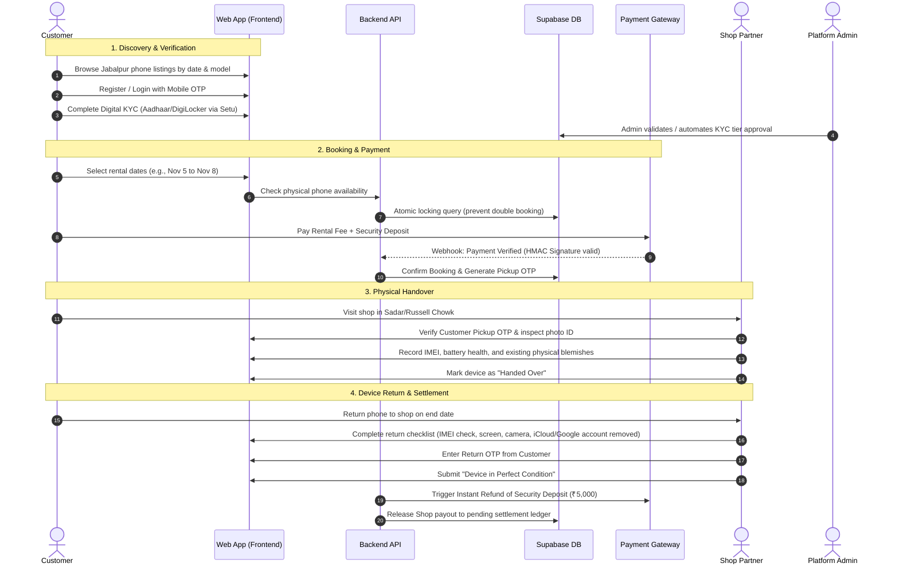

# 📱 RENTANY — Project Overview

> **Brand**: **RENTANY** (`rentany.in`)  
> **Brand Palette**: `#B21F3A` (Royal Crimson), `#EDC79B` (Champagne Gold), `#3D250B` (Deep Espresso)  
> **Marketplace**: Hyperlocal mobile-phone rental marketplace connecting verified local mobile shops in Jabalpur, Madhya Pradesh with trusted customers.

---

## 1. Executive Summary

**RENTANY** (`rentany.in`) is a specialized two-sided rental marketplace operating in Jabalpur, Madhya Pradesh. The platform enables local multi-brand mobile phone retail shops to monetize idle display, demo, pre-owned, and premium inventory by renting them to thoroughly verified customers for durations ranging from 1 to 30 days.

Customers obtain immediate access to high-end flagship smartphones (Apple iPhone, Samsung Galaxy S/Z Series, Google Pixel, OnePlus) for photography, travel, events, content creation, temporary phone replacement, or pre-purchase evaluation without bearing the full retail price.

---

## 2. Local Market Context: Jabalpur, Madhya Pradesh

Jabalpur is a Tier-2 hub in Central India with distinct demographic and economic characteristics:
1. **Tourism & Content Creation Hub**: Gateway to world-renowned natural and wildlife destinations:
   - **Bhedaghat Marble Rocks & Dhuandhar Falls** (huge demand for iPhone 4K HDR camera rentals for day-trips).
   - **Kanha, Bandhavgarh, and Pench National Park safari transit** (photographers renting phones with telephoto lenses).
2. **Wedding & Festive Capital of Mahakoshal**: Massive seasonal demand during wedding seasons for flagship cameras and backup phones.
3. **Large Student Population**: Prominent educational institutions including **IIITDM Jabalpur**, Jabalpur Engineering College (JEC), Netaji Subhash Chandra Bose Medical College, and Rani Durgavati Vishwavidyalaya (RDVV). Students frequently require test devices for mobile app development, events, or short-term usage.
4. **Established Mobile Retail Densities**: Clustered electronics and mobile markets across:
   - **Russell Chowk & Ganjipura** (the wholesale and retail heart of electronics in Jabalpur).
   - **Gorakhpur Market & Sadar Bazar** (affluent commercial belts with high smartphone adoption).
   - **Wright Town & Napier Town** (central shopping and corporate districts).

---

## 3. The Problem & Value Proposition

### For Customers (Renters)
- **High Purchase Barrier**: Premium smartphones cost ₹60,000 to ₹1,60,000, creating severe financial barriers for short-term needs (events, trips, app testing).
- **Zero Trust in Informal Rentals**: Informal rentals from acquaintances involve awkward negotiations, lack of invoices, and high dispute risks.
- **Value Proposition**: Transparent per-day pricing, instant digital KYC, contactless booking, physical device inspection at verified shops, and swift automated security deposit refunds.

### For Local Mobile Shops (Partners)
- **Depreciating Idle Capital**: Open-box, demo, refurbished, and trade-in smartphones sit in display cases, losing value every week.
- **Fear of Device Theft**: Individual shopkeepers cannot afford enterprise risk underwriting or background check infrastructure.
- **Value Proposition**: Zero-risk customer discovery, platform-backed digital identity verification (DigiLocker/Aadhaar), legal rental contract generation, automated escrow payments, and security deposit retention guarantees in case of damage or theft.

---

## 4. Platform Business Model & Economics

```
+-------------------------------------------------------------+
|                      CUSTOMER PAYS                          |
|  [Rental Fee] + [Platform Service Fee] + [Security Deposit] |
+-------------------------------------------------------------+
                               |
                               v
+-------------------------------------------------------------+
|                  ESCROW / HOLDING ACCOUNT                   |
+-------------------------------------------------------------+
          |                                        |
          | (On Successful Return)                 | (Post-Return Payout)
          v                                        v
+--------------------+                   +--------------------+
| CUSTOMER RECEIVES  |                   |   SHOP RECEIVES    |
| Security Deposit   |                   |  Rental Fee Payout |
| Refunded (100%)    |                   | Less Platform Cut  |
+--------------------+                   +--------------------+
                                                   |
                                                   v
                                         +--------------------+
                                         | PLATFORM REVENUE   |
                                         | 12% - 18% Take-Rate|
                                         +--------------------+
```

### Unit Economics Example (3-Day iPhone 15 Pro Rental)
- **Daily Rental Rate**: ₹1,200/day x 3 days = ₹3,600
- **Platform Fee (15%)**: Included in rental / or ₹540 platform commission
- **Refundable Security Deposit**: ₹5,000 (standard hold for verified Tier-1 customers)
- **Total Paid at Checkout**: ₹8,600
- **Post-Inspection Settlement**:
  - Customer gets ₹5,000 security deposit refunded immediately.
  - Shop Partner receives ₹3,060 (₹3,600 - 15% platform fee).
  - Jabalpur Rent retains ₹540 gross margin.

---

## 5. End-to-End User Journey



---

## 6. High-Priority Risk Mitigation

| Risk Vector | Platform Countermeasure |
| :--- | :--- |
| **Phone Theft / Non-Return** | Mandatory DigiLocker OKYC (UIDAI verified address), physical shop verification, IMEI blacklist database logging, signed digital rental agreement, police FIR escalation protocol. |
| **Device Damage / Screen Crack** | Standardized pre-handover photo audit, tiered refundable security deposit, damage indemnity clause in customer contract. |
| **Account Lock (iCloud / FRP)** | Handover checklist requires customer to sign out of Apple ID / Google Account in front of the shopkeeper prior to return OTP confirmation. |
| **Double Booking Same Phone** | Concurrency-safe PostgreSQL transactional range locks (`tstzrange` with exclusion constraints) preventing overlapping dates. |
| **Late Return** | Automated late penalty fee deducted incrementally from the refundable security deposit per 6 hours delayed. |

---

## 7. Next Reference Links
- High-level architecture: [[System-Architecture]]
- Current project state: [[PROJECT-STATUS]]
- Detailed roadmap: [[MASTER-PLAN]]
- Database schema: [[Database-Schema]]
